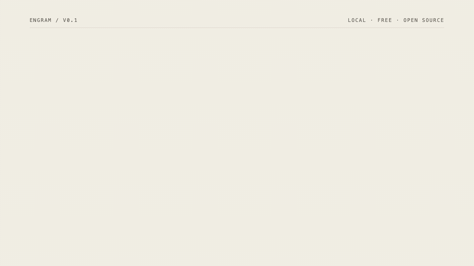
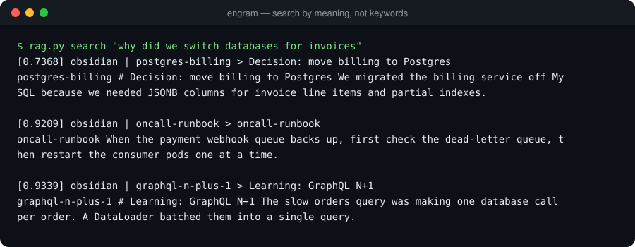
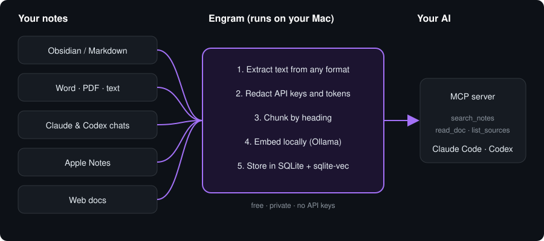
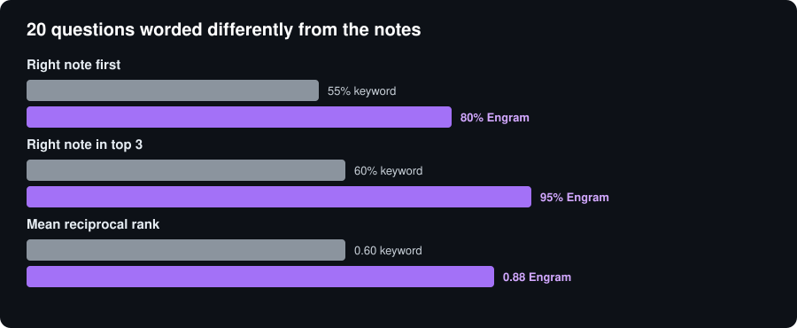
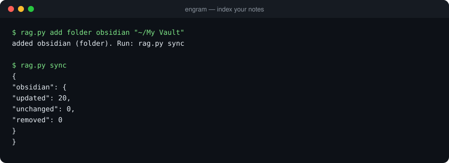

<div align="center">

# 🧠 Engram

### Claude forgets. Engram doesn't.

Free, local memory for Claude Code. Engram indexes your notes, documents, chats and GitHub markdown into a vector database and gives Claude a search tool, so it can use what you already figured out.

[](https://github.com/aayushhzz/engram/actions/workflows/test.yml)




[Watch the 30-second demo](docs/demo.mp4) · [For AI assistants: llm.txt](llm.txt) · [Install guide](INSTALL.md)

</div>

---

## Why

Every session, Claude starts from zero. It doesn't know you picked Postgres for JSONB, that the flaky tests came from a shared database, or that you solved this exact bug in a chat last month.

Engram turns that history into **embeddings**, the vectors AI uses to match by meaning, not keywords. Ask *"why did we switch databases for invoices?"* and Claude finds the note that says *"moved billing off MySQL for JSONB columns"*, even though the words barely overlap.



## Features

- 🔎 **Search by meaning.** Three MCP tools for Claude Code: `search_notes`, `read_doc`, `list_sources`.
- 📂 **Every format you write in.** Markdown, text, Word, PDF, RTF, OpenDocument, HTML and more, from any folder.
- 💬 **Learns from your chats.** Index Claude Code and Codex conversations. Each question is stored with its answer.
- 🐙 **Your GitHub markdown.** READMEs and docs from your public repos, cached by git hash so re-syncs are fast.
- 🍎 **Apple Notes, web links, Google Docs exports.** All optional.
- 🔒 **Private by default.** Embeddings run on your machine with Ollama. No API keys, no cloud index. Tokens are redacted before anything is stored.
- ⚡ **Incremental.** Only new or changed documents are re-embedded.
- 🧪 **Tested.** Offline test suite, a retrieval benchmark, and an impact eval with Claude.



## Quick start

**1. Install the prerequisites**

```bash
brew install ollama          # local embedding model runner
brew install gh              # optional: only for the GitHub source
claude --version             # Claude Code CLI must be installed
```

**2. Install Engram**

```bash
git clone https://github.com/aayushhzz/engram.git
cd engram
./install.sh --vault "$HOME/Documents/Obsidian Vault"   # or just ./install.sh
```

**3. Restart Claude Code and ask**

> *"What did we decide about API versioning?"*
> *"How did I fix the OOM kills last time?"*

Check it any time with `~/.local/share/engram/venv/bin/python rag.py doctor`.

The easiest install is to give [`INSTALL.md`](INSTALL.md) to Claude Code and say *"Install Engram using INSTALL.md."* It asks for your notes folder and offers the optional sources.

## Connect more sources

Your notes folder is the main source. Everything else is opt-in:

| Source | Command | Notes |
|---|---|---|
| 📁 Notes folder or Obsidian vault | `rag.py add folder obsidian "PATH"` | All formats in the table below |
| 💬 Claude Code chats | `rag.py add claude-chats claude-chats [DAYS]` | Prompts and replies only; tool output skipped |
| 💬 Codex chats | `rag.py add codex-chats codex-chats [DAYS]` | Reads `~/.codex/sessions` |
| 🐙 GitHub markdown | `rag.py add github github [USER]` | Public repos via your `gh` login |
| 🍎 Apple Notes | `rag.py add apple-notes apple-notes` | macOS asks for permission once |
| 🌐 Web links | `rag.py add links doc-links` | One URL per line in `inbox/urls.txt` |
| 📝 Google Docs | `rag.py add folder google-docs "PATH"` | Download from Drive as `.docx`, `.md` or `.pdf` |

Then `rag.py sync`. `rag.py remove NAME` disconnects a source and deletes its data.

## Commands

```bash
PY=~/.local/share/engram/venv/bin/python
$PY rag.py sync                       # index new and changed documents
$PY rag.py search "your question"     # search from the terminal
$PY rag.py sources                    # sources and document counts
$PY rag.py doctor                     # health check
$PY rag.py remove NAME                # disconnect a source
```

## Results

**Retrieval benchmark.** 20 questions worded differently from the notes that answer them (`evals/run_eval.py`):

| | Keyword search (BM25) | **Engram** |
|---|---|---|
| Right note ranked first | 55% | **80%** |
| Right note in top 3 | 60% | **95%** |
| Mean reciprocal rank | 0.60 | **0.88** |



**Impact on Claude.** The same 20 questions asked to Claude Sonnet 5.5, with and without Engram, on a fictional vault (`evals/impact/`):

| | Claude alone | **Claude + Engram** |
|---|---|---|
| Team-specific questions answered correctly | 0 / 20 | **20 / 20** |
| "I don't know" on questions the notes can't answer | 3 / 3 | 3 / 3 |
| Secret from the notes repeated | 0 | 0 |

These are small, hand-written sets. Your results will vary, and real notes are messier than the fictional vault. The baseline was graded by keyword matching, and its handful of matches were general-knowledge answers, so they are counted as misses. The Engram answers were checked by hand.

Run them yourself with `$PY evals/run_eval.py` and `$PY evals/impact/run_impact.py`.

## How it works

1. **Extract** text from every file, whatever its format.
2. **Redact** API keys, tokens and passwords.
3. **Chunk** by heading, and chats by question and answer.
4. **Embed** each chunk locally with `nomic-embed-text` through Ollama.
5. **Store** text and vectors in one SQLite file (`sqlite-vec`).
6. **Serve** search to Claude over MCP.



## Supported formats

| Kind | Formats |
|---|---|
| Notes and text | `.md` `.markdown` `.txt` `.text` `.org` `.rst` `.adoc` `.tex` `.csv` |
| Documents | `.docx` `.doc` `.rtf` `.rtfd` `.odt` `.pdf` |
| Web | `.html` `.htm` `.webarchive` |

`.doc`, `.rtf`, `.rtfd` and `.webarchive` use macOS's built-in `textutil`. On Linux, `.docx`, `.odt`, PDF and HTML work. Scanned PDFs without a text layer can't be read.

## Privacy

- Notes never leave your machine. Embeddings come from a local model.
- Search results go to the assistant you're talking to, so only index what you're comfortable sharing with it.
- Credentials are redacted before indexing. The patterns cover Slack, GitHub, OpenAI and Anthropic style keys, AWS, and `key=value` secrets, but no pattern list catches everything.
- Chat indexing skips tool calls and tool output, where secrets usually appear.
- `sources.json`, `inbox/` and the index are git-ignored, so your personal config stays out of the repo.

## Troubleshooting

| Symptom | Fix |
|---|---|
| `ollama: not reachable` | `brew services start ollama`, or open the Ollama app. Keep only one Ollama server running. |
| `embedding_model: missing` | `ollama pull nomic-embed-text` |
| `Ollama embed failed (HTTP 400)` | Restart Ollama and run `rag.py sync` again. Large inputs are batched automatically. |
| `skip FILE: ...` during sync | That file couldn't be read. Other files still index. |
| Claude shows `engram` as failed | Run `~/.local/share/engram/venv/bin/python mcp_server.py < /dev/null` to see the error. |

More in [`llm.txt`](llm.txt) (section 7) and [`INSTALL.md`](INSTALL.md).

## Project layout

| Path | What it is |
|---|---|
| `install.sh`, `INSTALL.md` | One-command installer and its assistant-readable procedure |
| `rag.py` | Indexing, redaction, search, source management, CLI |
| `connectors.py` | Source readers (folders, chats, GitHub, Apple Notes, links) |
| `mcp_server.py` | MCP server for Claude Code |
| `tests/` | Offline test suite (`python -m pytest tests -q`) |
| `evals/` | Retrieval benchmark, self-check, and impact eval |
| `demo/` | Source for the demo video: HTML composition, synthesized soundtrack, capture scripts |
| `llm.txt` | Full product context for AI assistants |

## Development

```bash
python3 -m venv ~/.local/share/engram/venv
~/.local/share/engram/venv/bin/pip install -r requirements.txt -r requirements-dev.txt
~/.local/share/engram/venv/bin/python -m pytest tests -q
```

The tests use a deterministic fake embedder, so they don't need Ollama. See [CONTRIBUTING.md](CONTRIBUTING.md) for how to add a source type.

## Roadmap

- Optional hosted embedding providers (Voyage, OpenAI) for people who don't want a local model
- Notion, Linear and Slack connectors
- A small web UI for browsing sources and search results
- Linux support for Apple Notes equivalents

## License

MIT. See [LICENSE](LICENSE).
